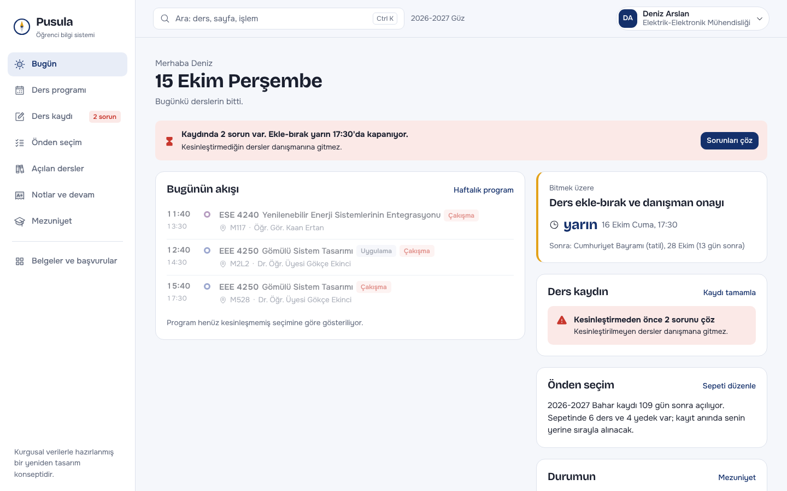
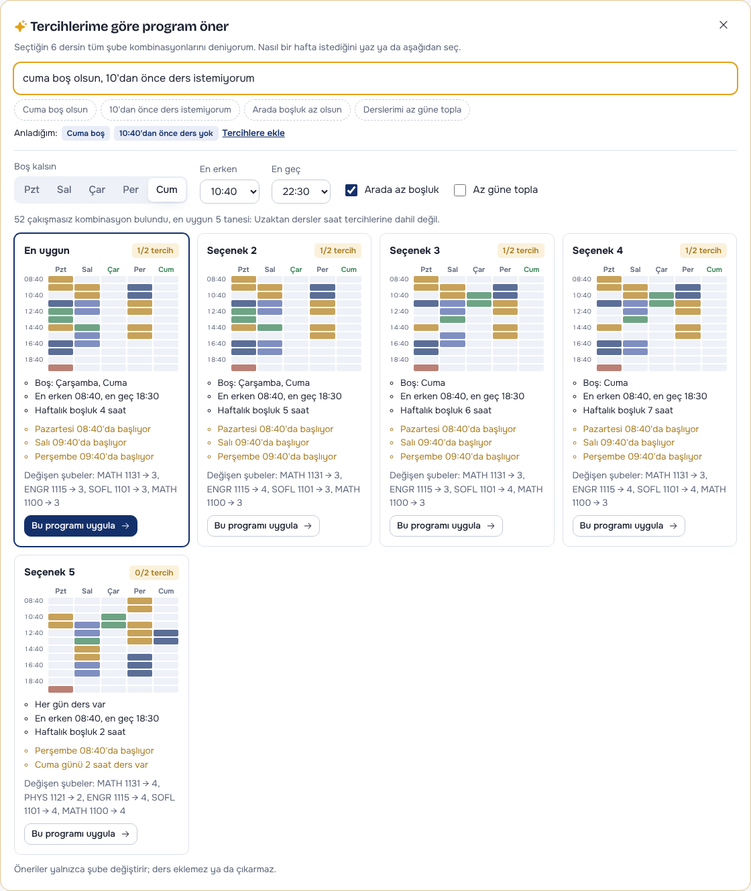
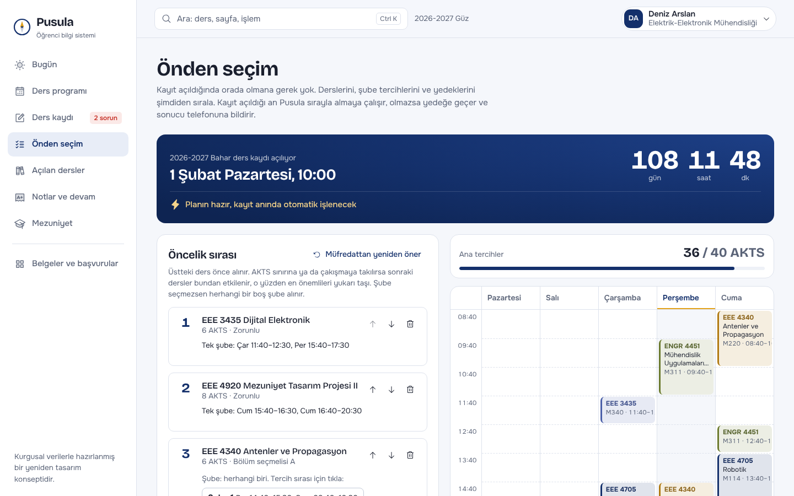
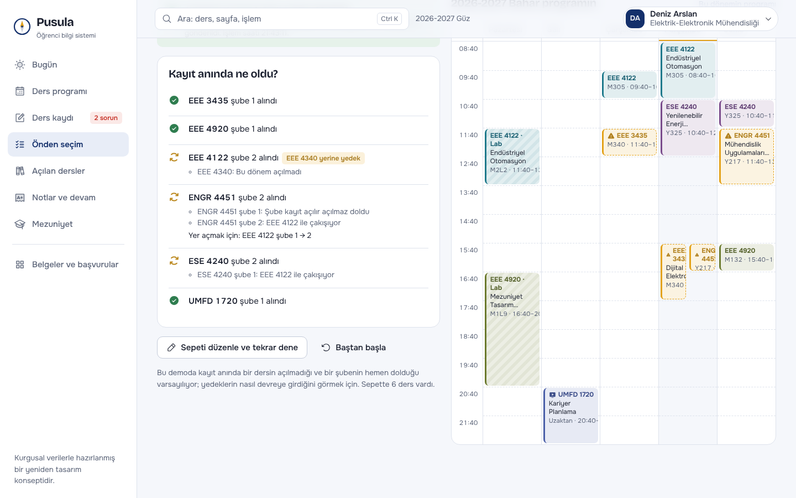
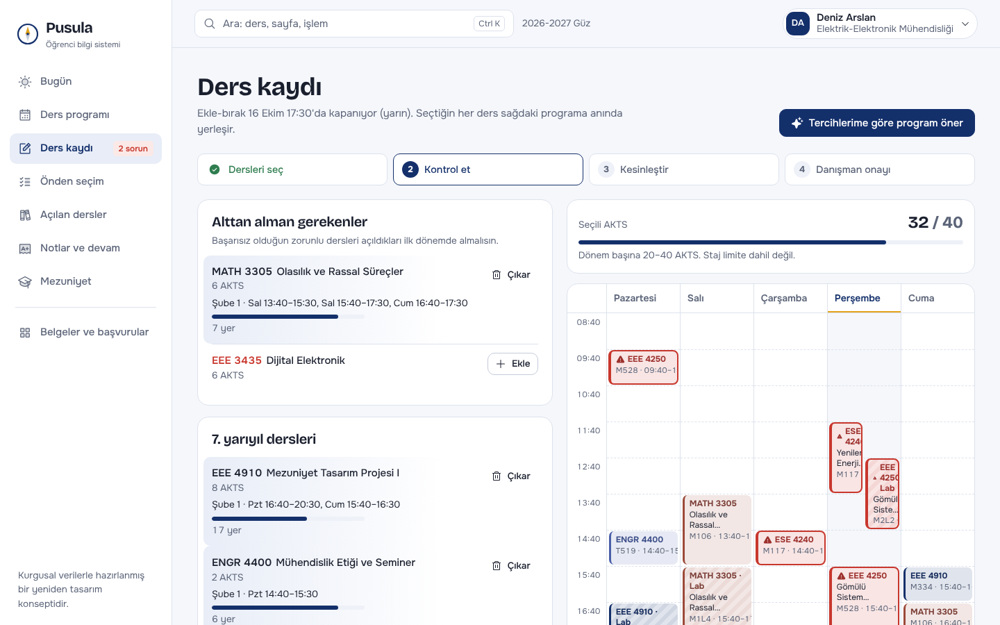
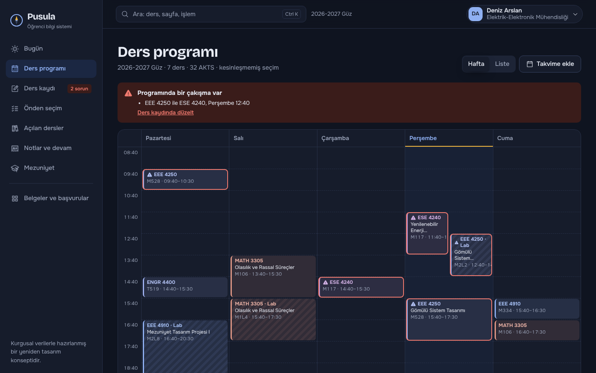
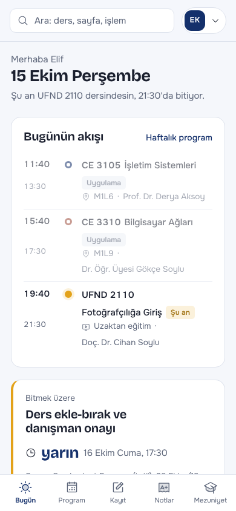
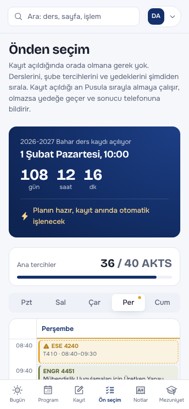
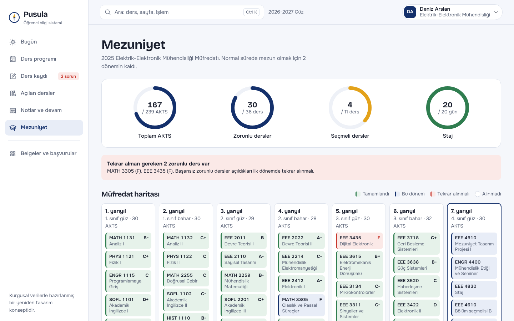

# Pusula — öğrenci bilgi sistemi yeniden tasarımı

Yaşar Üniversitesi OBS'nin öğrenci tarafı için hızlı, anlaşılır ve telefonda da rahat kullanılan bir yeniden tasarım konsepti. Odak noktası **ders kaydı** sırasında en sık yaşanan sorunlar.

**Canlı demo:** https://cemaksu229.github.io/obs-redesign/

> Tüm öğrenci, ders, şube ve not verileri kurgusaldır. Uygulama gerçek OBS'ye bağlanmaz.



## Çözdüğü sorunlar

Mevcut OBS gezilerek çıkarılan sorunlar ve Pusula'daki karşılıkları ([ayrıntılı analiz](docs/obs-haritasi.md)):

| Mevcut OBS | Pusula |
|---|---|
| Kayıt bir hız yarışı: öğrenci kayıt saatinde ekran başında olmak zorunda | **Önden seçim:** dersler, şube tercihleri ve yedekler önceden sıralanır; kayıt açılınca otomatik işlenir, sonuç telefona bildirilir |
| 48 menü öğesi, 8 grup, hiçbir grubun başlığı yok | 7 adlandırılmış ana bölüm, geri kalanı gruplanmış tek sayfada, her şey **Ctrl+K** ile aranabilir |
| Ders programı saat saat uzun bir liste, çakışmalar görünmüyor | Haftalık ızgara, "şu an" çizgisi, çakışmalar kırmızı, telefonda gün gün görünüm, takvime aktarma (.ics) |
| Açılan derslerde her şube ayrı satır, saat/hoca/kontenjan yok | Şubeler tek kartta: gün-saat, öğretim elemanı, kalan kontenjan çubuğu, bölüm/sınıf filtresi |
| Kayıtta kontenjan, çakışma ve kurallar ancak "Kontrol et" sonrası görülüyor | Seçtikçe canlı program önizlemesi ve anlık kural kontrolü, tek tıkla **çakışmasız şube bulma** |
| Uygun programı bulmak için şubeleri tek tek denemek gerekiyor | **Program önerici:** "Cuma boş olsun, 10'dan önce ders istemiyorum" yazarsın, tüm şube kombinasyonları denenip en uygun programlar önerilir |
| Mezuniyet ilerlemesi "kurallar eksik" deyip hesaplanmıyor | AKTS, zorunlu, seçmeli ve staj halkaları, renkli müfredat haritası, kalan dersler listesi |
| Her sayfa açılışında modal duyuru | Kapatılabilir duyurular ve öğrenciye özel "son gün" uyarısı ana sayfada |
| Sayfaların adresi yok (iframe) | Her ekranın kendi adresi var, yer imi ve paylaşım yapılabilir |

## Program önerici: istediğin haftayı yaz, programı o kursun

OBS'de "Cuma boş olsun" demek için öğrenci şubeleri tek tek deneyip kâğıt üzerinde program çizmek zorunda. Pusula'da ders kaydı ekranındaki **"Tercihlerime göre program öner"** ile:

- Tercihlerini düz Türkçe yazarsın: *"cuma boş olsun, 10'dan önce ders istemiyorum, arada boşluk az olsun"*. Pusula ne anladığını etiketlerle gösterir; istersen gün, en erken/en geç saat ve "az boşluk", "az güne topla" seçeneklerini butonlarla düzeltirsin.
- Seçtiğin derslerin **tüm şube kombinasyonları** denenir, kesin çakışanlar ve dolu şubeler elenir, kalanlar tercihlerine göre sıralanır.
- Her öneri küçük bir haftalık önizleme, boş kalan günler, en erken/en geç saat, haftalık boşluk ve hangi tercihlerin tutmadığıyla gelir. **"Bu programı uygula"** şubeleri tek tıkla değiştirir.
- Bir tercih imkânsızsa nedenini söyler: *"Cuma boş kalamaz: MATH 1131 dersinin açık olan her şubesinde cuma günü ders var."*

Tercih ayrıştırma şu an kural tabanlı çalışıyor (gün adları, saatler, "boşluk", "az gün" gibi ifadeler). Bir sonraki adım, bu katmanı bir dil modeline bağlayıp serbest cümleleri ("salı öğleden sonra işteyim") de anlamak; bunun için uygulamanın bir sunucusu olması gerekir.



## Önden seçim: kayıt saatinde orada olmana gerek yok

OBS'de ders kaydı, kayıt açıldığı dakikada sisteme girebilenin kazandığı bir yarış. Derste, işte ya da yolda olan, ya da sistem yoğunluktan yavaşladığında bekleyen öğrenci istediği şubeyi kaçırıyor. Pusula'da bir sonraki dönemin kaydını önceden planlarsın:

1. **Sıralı sepet:** Dersleri öncelik sırasına dizersin. Müfredatından bir sonraki dönemin dersleri ve alttan derslerin otomatik önerilir.
2. **Şube tercihi:** Her ders için şubeleri tercih sırasıyla seçersin (1. şube 2, olmazsa şube 1). Seçmezsen herhangi bir boş şube alınır.
3. **Yedek dersler:** Ders açılmazsa ya da dolarsa yerine sırayla denenecek yedekler. Aynı seçmeli grubundan öneriler gelir.
4. **Ön kontrol:** Kayıt açılmadan önce ilk tercihlerinle oluşacak program, AKTS sınırı, çakışmalar, ön koşullar ve "yedeğe düşersen şu dersle çakışırsın" uyarıları gösterilir.
5. **Kayıt anında otomatik işleme:** Dersler sırayla alınır. Şube doluysa sıradaki tercihe, ders açılmadıysa yedeğe geçilir. Gerekirse önceden alınan bir dersin şubesi tercih listesi içinde değiştirilerek yer açılır. Her kararın nedeni kaydedilir.
6. **Bildirim:** Sonuç telefona ve bilgisayara sistem bildirimi olarak gelir ("6 dersten 6'sı alındı, 1'i yedekten"). İstenirse alınan dersler otomatik kesinleştirilip danışmana gönderilir.

Demoda kayıt açılışı **"şimdi simüle et"** ya da **"10 saniye sonra simüle et"** ile denenebilir. 10 saniyelik seçenekle uygulamayı arka plana alınca bildirimin geldiği görülür. Simülasyonda bilinçli olarak bir ders açılmaz ve bir şube hemen dolar, böylece yedeklerin nasıl devreye girdiği görünür.

> Gerçek bir sistemde bu işlem sunucuda, tüm öğrencilerin sepetleri adil bir sırayla (ör. önce mezuniyete yakın olanlar, aynı sınıf içinde kura) işlenerek yapılmalıdır; böylece milisaniye yarışı ortadan kalkar. Uygulama kapalıyken bildirim için de bir push sunucusu gerekir. Bu demoda bildirim, uygulama açıkken ya da arka plandayken çalışır (Android, Windows, macOS; iPhone'da ana ekrana eklenince).

| Sepet ve ön kontrol | Kayıt anının sonucu |
|---|---|
|  |  |

## Ders kaydı kuralları

Kayıt ekranı, üniversitenin ders kayıt rehberindeki kuralları anlık kontrol eder:

- **AKTS sınırı:** dönem başına 20–40 AKTS, ilk iki yarıyılda en fazla 30, AGNO 2,00'ın altındaysa en fazla 32. Staj limite dahil değil.
- **Çakışma:** çakışan iki yeni ders alınamaz. F ile kalınan dersin çakışmasına izin verilir ve uyarı gösterilir.
- **Ön koşul:** geçilmemiş ön koşulu olan ders eklenemez.
- **Kontenjan:** dolu şube seçilemez, varsa boş şube önerilir.
- **Alttan dersler:** başarısız zorunlu ders açıldığı ilk dönemde alınmalıdır.
- **Sınamalı öğrenci:** üst sınıf dersi alamaz.
- **Tekrar:** C-, D+, D ile geçilen dersler tekrar alınabilir, daha yüksek notla geçilenler alınamaz.

Akış: **Dersleri seç → Kontrol et → Kesinleştir → Danışman onayı**. Hata varken kesinleştirme butonu kapalıdır.



## Demo öğrencileri

Sağ üstteki menüden öğrenci değiştirilebilir. Her biri farklı bir bölümden ve farklı bir durumu gösteriyor:

| Öğrenci | Bölüm | Gösterdiği durum |
|---|---|---|
| Deniz Arslan | Elektrik-Elektronik Müh., 4. sınıf | Taslak kayıt, alttan ders eksik, F ile kalınan dersin izinli çakışması |
| Elif Karaca | Bilgisayar Müh., 3. sınıf | Onaylanmış kayıt, açıklanmış ara sınav notları |
| Mert Yıldız | Endüstri Müh., 2. sınıf | Sınamalı (AGNO < 2,00), 32 AKTS sınırı, henüz ders seçmemiş |
| Ece Yılmaz | Bilgisayar Müh., 1. sınıf | Kaydını henüz yapmamış yeni öğrenci: program önericiyi denemek için en iyisi |
| Zeynep Aydoğan | İşletme, 1. sınıf | İlk dönem, 30 AKTS sınırı, transkript yok |

Menüdeki "Bu öğrencinin kaydını demo başına al" seçeneği, sunum öncesi her şeyi sıfırlar.

## Ekranlar

| Koyu mod | Telefon |
|---|---|
|  |   |



## Teknik

- **React + Vite**, yönlendirme için `react-router` (HashRouter, GitHub Pages uyumlu)
- **PWA:** telefona ve masaüstüne uygulama olarak yüklenebilir, çevrimdışı açılır (`vite-plugin-pwa`)
- Yazı tipleri: Bricolage Grotesque ve Onest (Türkçe karakter desteği tam), ikonlar: Phosphor
- Arka uç yok: kurgusal veri `src/data/` içinde, seçimler tarayıcıda saklanır

```
src/
  data/        kurgusal katalog, müfredatlar, şubeler, öğrenciler, akademik takvim
  lib/         çakışma bulma ve şube çözücü, program önerici, kayıt kuralları, önden seçim motoru, bildirimler, not ortalaması, mezuniyet hesabı
  components/  kabuk, haftalık program ızgarası, arama paleti
  pages/       Bugün, Program, Kayıt, Önden seçim, Açılan dersler, Notlar, Mezuniyet, Belgeler
```

### Çalıştırma

```bash
npm install
npm run dev       # geliştirme sunucusu
npm run build     # dist/ klasörüne üretim çıktısı
```

`main` dalına her push'ta GitHub Actions uygulamayı derleyip GitHub Pages'e yayınlar.

## Geliştirme süreci

Bu proje "Mühendislik Uygulamaları için Üretken Yapay Zeka" dersi ödevi olarak Claude ile birlikte geliştirildi:

1. Mevcut OBS, tarayıcı üzerinden salt okunur gezilerek analiz edildi (kişisel veri alınmadı): [docs/obs-haritasi.md](docs/obs-haritasi.md)
2. Üniversitenin ders kayıt rehberindeki kurallar çıkarıldı
3. Tasarım için `frontend-design`, `redesign-existing-projects` ve `web-design-guidelines` skill'leri kullanıldı (`.claude/skills/`)
